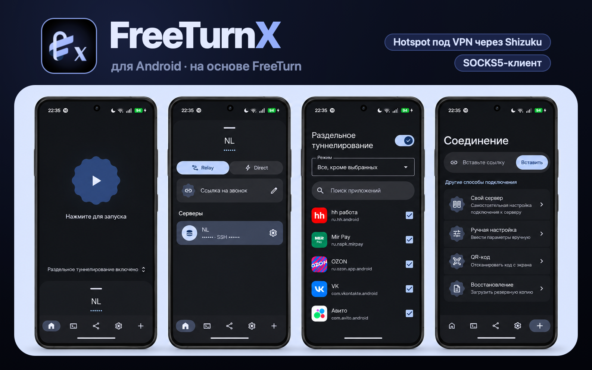

**FreeTurnX** - Android-клиент на основе [FreeTurn](https://github.com/hackdiaz-dev/turn-proxy-android). В нём есть всё, что умеет FreeTurn, плюс собственные функции в разделе настроек **«FreeTurnX: Фичи»**. Обновления FreeTurn регулярно вливаются в FreeTurnX.

> **Disclaimer.** Проект предназначен **исключительно для образовательных и исследовательских целей.**

## Фичи FreeTurnX

- **Hotspot под VPN через Shizuku.** Точка доступа раздаёт VPN без root: подключённые устройства выходят в интернет через туннель, на них ничего настраивать не нужно. Включается вместе с VPN. Нужны Android 13+ и запущенное приложение [Shizuku](https://shizuku.rikka.app/).
- **Kill switch раздачи.** Если приложение или VPN упали, точка доступа выключается сама - устройства не уйдут в интернет мимо VPN.
- **SOCKS5-клиент.** Подключает телефон к SOCKS5-прокси - например, к SOCKS5 Hotspot другого телефона с FreeTurn или FreeTurnX в той же Wi-Fi сети: адрес сканируется по QR. Перед подключением прокси проверяется, так что «Подключено» значит, что он отвечает. На главном экране, в плитке и виджете клиент показывается как обычное подключение; VPN и SOCKS5-клиент работают по очереди - Android держит только один VPN. Для устройств на точке доступа самого телефона нужен не SOCKS5, а «Hotspot под VPN через Shizuku».
- **QR для SOCKS5 Hotspot.** Телефон показывает QR со своим адресом в Wi-Fi сети, портом и паролем - устройство в той же сети сканирует его в SOCKS5-клиенте.
- **Плитки в шторке** «Hotspot под VPN» и «SOCKS5-клиент».

## Возможности FreeTurn

- **Несколько серверов**, клонирование конфигурации
- **Быстрая установка на VPS**
- **Обмен конфигами** по ссылке и QR-коду
- **Встроенный VPN** (WireGuard / AmneziaWG) без отдельного VPN-клиента
- **Локальный прокси** для внешнего клиента и **SOCKS5 Hotspot** для устройств в той же сети
- **Relay / Direct** - подключение через TURN или напрямую
- **Раздельное туннелирование**
- **Бэкапы**

## Установка

1. Скачайте APK из [последнего релиза](https://github.com/ftx-dev/freeturn-android/releases/latest): `arm64-v8a` - для большинства телефонов, `armeabi-v7a` - для старых 32-битных.
2. FreeTurnX - отдельное приложение (`com.freeturnx.app`) и ставится рядом с FreeTurn. Настройки переносятся бэкапом или ссылкой на конфиг.
3. Дальше FreeTurnX сам предлагает обновления из своих релизов.

## Требования

- **Android 7.0+** (API 24), для раздачи через Shizuku - **Android 13+**
- **Архитектура процессора:** `arm64-v8a` или `armeabi-v7a`
- **VPS** с сервером FreeTurn
- **Ссылка на звонок** для режима Relay; для Direct не требуется

## Версии

Версия FreeTurnX состоит из двух частей: `0.1-5.3.4` - это FreeTurnX `0.1` на основе FreeTurn `5.3.4`. Новая версия FreeTurnX или FreeTurn в основе - обе считаются обновлением.

## Сборка

Как у FreeTurn: `./gradlew :app:assembleDebug` (JDK 17, Android SDK). Ядро `freeturn.aar` скачивается из релизов free-turn-proxy при сборке. Helper раздачи и SOCKS5-клиента (`tether/`, tun2socks) уже собран в `app/src/main/jniLibs`; пересобрать - `tether/build.sh` (нужен Go).

## Благодарности

- **[hackdiaz-dev](https://github.com/hackdiaz-dev)** - [FreeTurn для Android](https://github.com/hackdiaz-dev/turn-proxy-android) и ядро [free-turn-proxy](https://github.com/hackdiaz-dev/free-turn-proxy), на которых основан FreeTurnX
- **[@Moroka8](https://github.com/Moroka8)** - форк ядра [vk-turn-proxy](https://github.com/Moroka8/vk-turn-proxy)
- **[@alexmac6574](https://github.com/alexmac6574)** - форк ядра [vk-turn-proxy](https://github.com/alexmac6574/vk-turn-proxy)
- **[@cacggghp](https://github.com/cacggghp)** - оригинальное [vk-turn-proxy](https://github.com/cacggghp/vk-turn-proxy)
- **[@MYSOREZ](https://github.com/MYSOREZ)** - оригинальный Android-клиент [vk-turn-proxy-android](https://github.com/MYSOREZ/vk-turn-proxy-android)
- **[xjasonlyu/tun2socks](https://github.com/xjasonlyu/tun2socks)** и **[Shizuku](https://github.com/RikkaApps/Shizuku)**
